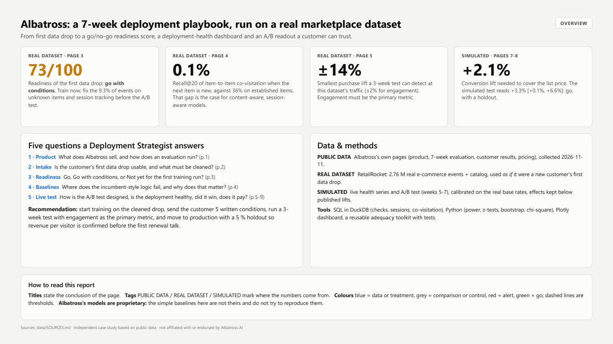

# Albatross: a 7-week deployment playbook, run on a real marketplace dataset

From first data drop to a go/no-go readiness score, a deployment-health dashboard and an A/B readout a customer can trust.

**[Report (PDF, 11 pages)](docs/Albatross_DeploymentCaseStudy.pdf)** · **[Interactive dashboard: deployment health & A/B results](https://albt-france.github.io/albatross-deployment/dashboard.html)** (also in [docs/dashboard.html](docs/dashboard.html), a single file that opens offline) · **[Customer playbook](playbook/)**

Independent case study based on public data · not affiliated with or endorsed by Albatross AI.

| | Key result | Data |
|---|---|---|
| 1 | The first data drop is **Go with conditions (73/100)**: usable for training, but 9.3 % of events point to items missing from the catalog, and only 21 % of sessions have 2+ events. | REAL DATASET |
| 2 | Item-to-item co-visitation finds the next item **31 %** of the time (Recall@20), **36 %** on established items, but only **0.1 %** when the next item is new. | REAL DATASET |
| 3 | At this dataset's traffic, a 3-week test can detect a **±2 %** change in engagement but only **±14 %** in purchases, so engagement has to be the primary metric. | REAL DATASET |
| 4 | In the simulated test, engagement rises **+20 %** (**+15 %** once novelty fades) and conversion **+3.3 %**. At list price the feed pays back above **+2.1 %** conversion. | SIMULATED |



## The scenario
Albatross deploys real-time "perception models" for product discovery on marketplaces. A new customer starts with a fixed
**7-week evaluation**: weeks 1-2 data integration, weeks 3-4 model training, weeks 5-7 a live A/B test of the Discovery Feed on the
homepage against the incumbent system (source: usealbatross.ai/evaluation).

This project plays the Deployment Strategist on that timeline. It **treats a public e-commerce event dataset (RetailRocket, 2.76 M events)
as a new customer's first data drop**, in the exact format Albatross asks for: event triplets (user ID, event type, item ID, timestamp)
plus a catalog. Weeks 1-4 run on that real data. Weeks 5-7 (live health, A/B test, business case) cannot be observed on a public dataset,
so they are **simulated** and labelled as such, with effects calibrated on the real base rates and kept below the results Albatross's customers published.

## Questions and answers
| # | Question | Page | Answer |
|---|---|---|---|
| 1 | What does Albatross sell, and how does an evaluation run? | 1 | Session-aware models that update on every click and make new listings recommendable within minutes; judged by a 7-week evaluation that ends in a live A/B test. Customers published +84 % (OfferUp) and +119 % (Wallapop) homepage engagement. |
| 2 | Is the first data drop usable? | 2 | Yes, no blocking issue. 17 automated checks: 9.3 % of events on items missing from the catalog, the last 2 days partial, 3.4 % of events from bot-like users, 28 % of add-to-carts with no earlier view. Filtering rules remove 3.6 % of events. |
| 3 | Is the customer ready for training? | 3 | Go with conditions (73/100): 139 days of history and a fully categorised catalog pass; short sessions, 19.8k events/day and a cold catalog (81 % of items with under 5 interactions) are conditions sent to the customer in writing. |
| 4 | Where does incumbent-style logic fail? | 4 | Popularity: Recall@20 of 1.5 %, shows 67 items. Co-visitation: 30.6 % overall, 0.1 % on new items, 0.8 % when the current item has no co-visitation history, and it ignores everything before the last item. |
| 5 | How should the A/B test be designed? | 5 | Visitor-level, 50/50, 21 days fixed, no peeking, SRM check daily; primary metric = feed clicks per visitor, because purchases are not readable at this traffic (±14 %). |
| 6 | Is the live deployment healthy? | 6 | All 5 injected incidents are detected (event stream cut, latency spike, duplicates, catalog stall, bots) with 0 false alarms. The catalog-stall rule alerts after 70 min: lower its threshold to 30 min. |
| 7 | Did the test win? | 7 | After finding and excluding a day-9 sample-ratio mismatch (mobile logging bug): feed clicks +20.2 % [+19.5, +21.0], week 3 +15.4 %, conversion +3.3 % [+0.1, +6.6], guardrails clean. Revenue per visitor is inconclusive. Decision: go to production with a 5 % holdout. |
| 8 | Does it pay? | 8 | Public pricing for a 3 M MAU marketplace is about EUR 314k / year. Break-even is +2.1 % conversion; the central case gives EUR +187k / year net (1.6x); the lower CI bound does not pay, hence the holdout. |

## Run the adequacy toolkit on any data drop
```bash
python -m venv .venv
.venv\Scripts\activate            # Windows (source .venv/bin/activate on macOS / Linux)
pip install -r requirements.txt
pip install -e .
python tests/sample_data.py examples
python -m adequacy check --events examples/events.csv --catalog examples/catalog.csv --out reports --name "Example customer"
pytest
```
It writes `reports/intake_report.md` and `.html` (checks graded OK / WARNING / BLOCKER, filtering waterfall, readiness scorecard, draft
message to the customer) plus CSV tables for a dashboard. Input format:

| file | required columns | notes |
|---|---|---|
| events (.csv or .parquet) | `user_id`, `event_type`, `item_id`, `timestamp` | Unix s / ms, or ISO-8601; the time zone is checked |
| catalog (.csv or .parquet) | `item_id` + any attributes | `category_id` and `n_properties` are used if present |

## Reproduce the whole study
1. Place the four RetailRocket CSV files in `data/raw/retailrocket/` (see [data/SOURCES.md](data/SOURCES.md); not redistributed here).
2. Run in order:
```bash
python src/load_dataset.py      # raw files -> event triplets + catalog (data/work, local)
python src/run_intake.py        # weeks 1-2: checks, filtering, readiness -> data/public/intake
python src/baselines.py         # offline baselines on a time split -> data/public/baselines
python src/ab_design.py         # base rates, power, MDE -> data/public/ab_design
python src/simulate.py          # SIMULATED weeks 5-7 (seed 42) -> data/simulated
python src/ab_readout.py        # SRM, effects, novelty, segments, decision
python src/health_monitor.py    # alert rules -> incident log
python src/business_case.py     # public pricing vs simulated customer
python src/build_dashboard.py   # docs/dashboard.html
python src/build_report.py      # docs/Albatross_DeploymentCaseStudy.pdf (headless Edge or Chrome)
```
Without the raw files, steps from `simulate.py` onwards still run, because they read the published aggregates. The notebooks in `notebooks/`
read the same aggregates.

## Repository
```
sql/                 01_intake_checks.sql · 02_adequacy.sql · 03_baselines.sql  (DuckDB)
src/adequacy/        reusable toolkit: checks.py, readiness.py, report.py, __main__.py
src/                 one script per step (see above) + charts.py
data/public/         Albatross facts (sourced, dated) + aggregates from the real dataset
data/simulated/      simulated health series, A/B readout, business case
notebooks/           01_intake · 02_adequacy · 03_baselines · 04_ab_test (short, commented)
playbook/            data request, follow-up, weekly report, escalation grid, go-live checklist
tests/               pytest on a synthetic data drop with injected anomalies
docs/                PDF report, dashboard, page previews
```

## Methods
- **SQL (DuckDB):** 14 intake checks and 4 filtering rules, written as plain SQL blocks a customer's engineer can re-run; sessions (30-minute gap);
  adequacy metrics (history, events per user, session length, matrix density, cold items, concentration, new-item arrivals); co-visitation and
  a time-split evaluation (16 weeks train, 4 weeks test, Recall@20, NDCG@20, catalog coverage, by segment).
- **Statistics (Python):** sample size for proportions and means; minimum detectable effect after 3 weeks; Welch z-tests; bootstrap (visitor
  resampling); chi-square sample-ratio test by day and device; Holm correction across segments; novelty read week by week.
- **Monitoring:** threshold rules that must hold for several 5-minute buckets, each with a severity, an owner and an action.
- **Business case:** confidence interval of the conversion lift -> low / central / high, public price list -> cost, break-even lift, sensitivity.
- **Albatross's models are proprietary.** The baselines here are deliberately simple, are not Albatross's models and do not estimate their performance.

AI-assisted workflow: I used Claude, mainly to write scripts faster. I drove the project: I defined the questions, chose and validated the data sources, made the analytical decisions and checked every result.

## Sources and licences
- Albatross facts: usealbatross.ai pages collected 2026-11-11, listed with URL and date in [data/public/albatross_facts.csv](data/public/albatross_facts.csv)
  and [data/SOURCES.md](data/SOURCES.md). Only facts and figures are reproduced; customer results are cited as published.
- RetailRocket e-commerce dataset, CC BY-NC-SA 4.0. Raw files not redistributed; derived aggregates shared under the same licence.
- Simulated data: `src/simulate.py`, seed 42; every assumption in [data/ASSUMPTIONS.md](data/ASSUMPTIONS.md).

## Limits
- RetailRocket is a 2015 e-commerce shop, not a 2026 second-hand marketplace: lower traffic, shorter sessions, hashed item properties.
- Weeks 5-7 are simulated: they show the checks, dashboards and reasoning, not real Albatross or customer performance.
- Offline recall on logged data does not predict an online lift; only the live A/B test does.
- Readiness thresholds and alert rules are this playbook's own choices, written down so they can be challenged.
- The business case uses assumed GMV, take rate and homepage share; only the pricing is public.
